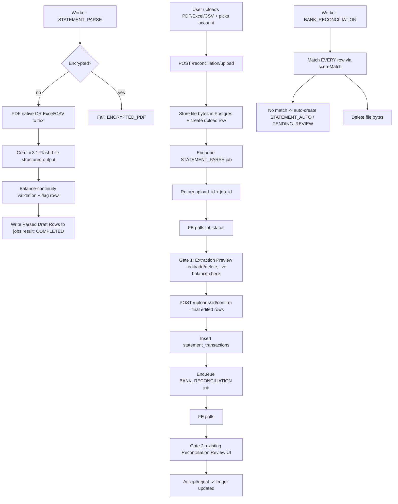

# Bank Statement PDF/Excel LLM Import — Implementation Plan

> Extends the existing **reconciliation** context. See
> [reconciliation/CONTEXT.md](../backend/internal/domain/reconciliation/CONTEXT.md) for the glossary and
> [ADR-0001](../backend/internal/domain/reconciliation/docs/adr/0001-pdf-ingestion-extends-reconciliation.md)
> for why this is not a new domain.

## 1. Overview

### Problem
Users track transactions via SMS parsing and manual entry. They want to upload a bank statement
(PDF, Excel, or CSV), have a small LLM extract every transaction into our normalized format,
**preview and correct** the extraction, confirm, and import — **without double-counting** anything
already tracked. The existing reconciliation matching engine is the dedup guard.

### Core principles
- **Two honest gates.** Extraction correctness ("did we read the file right?") is separate from
  duplicate resolution ("is this already in my ledger?").
- **Deterministic guard over a probabilistic parser.** Balance continuity validates the LLM.
- **Non-destructive.** Nothing enters the ledger until the user confirms; imported-but-unmatched rows
  land as `STATEMENT_AUTO` / `PENDING_REVIEW`, never silently trusted.
- **Reuse the matching engine verbatim.** No second dedup implementation.

### Resolved decisions (grill-with-docs session)

| # | Decision | Choice |
|---|---|---|
| 1 | Domain placement | **Extend `reconciliation`** (ADR-0001) |
| 2 | LLM model | **Gemini 3.1 Flash-Lite** (native PDF, GA multimodal) |
| 3 | Gate structure | **Two gates**: Extraction Preview → Reconciliation Review |
| 4 | Ingestion | **LLM for all formats**; retire deterministic excelize column-parser |
| 5 | Parse execution | **Async**, new `STATEMENT_PARSE` job; confirm enqueues existing `BANK_RECONCILIATION` |
| 6 | Draft staging | **Parse job result JSONB** + client-side edits; no new table |
| 7 | Account / period | **User picks account**; LLM verifies last-4 (warn on mismatch) + prefills period |
| 8 | Balance validation | **Best-effort continuity check**; balance delta = primary DEBIT/CREDIT signal |
| 9 | Endpoints / matching | Repurpose `/upload`; add `/draft` + `/confirm`; **match every confirmed row** (drop tail optimization) |
| 10 | Passwords | **Not supported in v1** — reject encrypted PDFs with a message (known limitation) |
| 11 | Preview editing | **Edit + delete + add**, live balance indicator; no skip/exclude |
| 12 | Categorization | LLM maps to **existing category/merchant IDs+names from DB**; null when no match |
| 13 | File storage | **Postgres `bytea`**, deleted after the final reconciliation job completes |

Stated (no vote): native Gemini **structured output** (`responseSchema`); **deterministic** row
flagging (not LLM self-confidence).

---

## 2. Architecture & Flow



### End-to-end sequence
1. **Upload** — user selects target account + file. Backend stores bytes (`bytea`), creates the
   `bank_statement_uploads` row, enqueues `STATEMENT_PARSE`, returns `upload_id` + `job_id`.
2. **Parse (worker)** — decrypt-check → extract (PDF native / Excel→CSV text) → Gemini structured
   output → balance validation → write Parsed Draft Rows + statement metadata to `jobs.result`.
3. **Extraction Preview (gate 1)** — FE loads draft rows, shows flagged rows, live balance indicator;
   user edits/adds/deletes; account last-4 mismatch warning; period prefilled.
4. **Confirm** — FE posts the final edited rows. Backend inserts `statement_transactions`, enqueues
   `BANK_RECONCILIATION`.
5. **Reconcile (worker)** — match every row; no-match → auto-create `STATEMENT_AUTO`/`PENDING_REVIEW`;
   delete stored file bytes.
6. **Reconciliation Review (gate 2)** — existing results UI + `PATCH .../results/:id/status`.

---

## 3. Data Model Changes

No new tables for drafts (they live in `jobs.result`). Changes:

### 3.1 File bytes on the upload
```sql
-- Migration: 0XX_statement_upload_file_bytes.sql
-- +goose Up
ALTER TABLE bank_statement_uploads
    ADD COLUMN file_bytes  BYTEA,
    ADD COLUMN file_mime   VARCHAR(128),
    ADD COLUMN parse_job_id UUID REFERENCES jobs(id);

COMMENT ON COLUMN bank_statement_uploads.file_bytes IS
  'Transient raw upload; deleted after the BANK_RECONCILIATION job completes';

-- +goose Down
ALTER TABLE bank_statement_uploads
    DROP COLUMN IF EXISTS parse_job_id,
    DROP COLUMN IF EXISTS file_mime,
    DROP COLUMN IF EXISTS file_bytes;
```
Note: `file_bytes` is set NULL by the reconciliation worker on completion (or failure cleanup job).

### 3.2 New job type
`JobTypeSTATEMENTPARSE JobType = "STATEMENT_PARSE"` (jobs.dto.go) and
`TaskStatementParse TaskType = "statement:parse"` (tasks/base.task.go), wired into `Worker.Handle`.

### 3.3 `STATEMENT_PARSE` job result shape (`jobs.result`)
```jsonc
{
  "status": "COMPLETED",                 // or PARSE_FAILED / ENCRYPTED_PDF / NOT_A_STATEMENT / TOO_MANY_PAGES
  "statement": {
    "bank_name": "HDFC Bank",
    "account_last4": "4821",
    "period_start": "2026-01-01",
    "period_end": "2026-01-31",
    "opening_balance": 15230.55,
    "closing_balance": 18110.00,
    "currency": "INR"
  },
  "balance_check": { "reconciles": false, "expected_closing": 18110.00, "computed_closing": 17810.00, "tolerance": 0.01 },
  "rows": [
    {
      "index": 0,
      "transaction_date": "2026-01-03",
      "description": "UPI/SWIGGY/BANGALORE",
      "amount": 450.00,
      "type": "DEBIT",                    // derived from balance delta when available
      "reference_number": "402312345678",
      "running_balance": 14780.55,
      "category_id": "uuid-or-null",      // mapped to an EXISTING user category
      "category_name": "Food",
      "merchant_id": "uuid-or-null",
      "merchant_name": "Swiggy",
      "flags": ["balance_mismatch"]        // deterministic: balance_mismatch | missing_amount | unparseable_date
    }
  ]
}
```

---

## 4. LLM Parsing Design

### 4.1 Model & invocation
- **Gemini 3.1 Flash-Lite** via the existing `genai.Client` (`aiServices/gemini.service.go`).
  Add a statement-parse method; do **not** change the SMS/receipt model.
- **Structured output**: set `ResponseMIMEType: "application/json"` + `ResponseSchema` (the shape in §3.3).
  Replaces the hand-rolled markdown/JSON stripping used by SMS parsing.
- **PDF** → passed natively as a `genai` file/blob part (page-images). **Excel/CSV** → `excelize`/`encoding/csv`
  extract every sheet to CSV text → passed as a text part. Both hit the same schema.

### 4.2 Prompt structure
- Role: "Extract every transaction line from this bank statement. Do not invent rows. Return only rows
  present in the document."
- Inputs interpolated: the user's **category list** (`id`, `name`) and **merchant list** (`id`, `name`)
  from the DB — instruct the model to map each row to an existing `id` or return `null`. Never fabricate IDs.
- Ask for statement metadata (bank, account last-4, period, opening/closing balance) + rows.
- Explicit rule: emit `amount` as a **positive** number; set `type` from the running-balance direction
  when balances exist.

### 4.3 DEBIT/CREDIT inference precedence
1. **Balance delta** (`running_balance` moved down → DEBIT, up → CREDIT) — most reliable.
2. Explicit **Dr/Cr** indicator column.
3. **Separate** withdrawal/deposit columns.
4. Amount **sign**.
Map to existing `TxnType` (`DEBIT`/`CREDIT`; income/refund/etc. remain user-adjustable in review).

### 4.4 Balance-continuity validation (deterministic, post-LLM)
- Row-level: `prev_running_balance ± amount == running_balance` (± rounding tolerance `0.01`).
- Statement-level: `opening + Σcredits − Σdebits == closing`.
- On break: set `flags: ["balance_mismatch"]` on the offending row(s); surface in preview.
- **Best-effort**: if `running_balance`/`opening`/`closing` absent (e.g. many credit-card statements),
  skip validation and fall back to §4.3 for type inference.

### 4.5 Deterministic row flags (not LLM self-confidence)
`balance_mismatch`, `missing_amount`, `unparseable_date`. These drive the "check these rows" highlight
in the Extraction Preview.

---

## 5. API Endpoints

All under the existing reconciliation router; auth + account-ownership as today.

| Method | Path | Purpose |
|---|---|---|
| `POST` | `/reconciliation/upload` | multipart: file + `account_id` + optional period. Store bytes, enqueue `STATEMENT_PARSE`. Returns `upload_id`, `job_id`. **(repurposed)** |
| `GET` | `/reconciliation/uploads/:id/parse-status` | Poll the parse job (or reuse `jobs` status endpoint). |
| `GET` | `/reconciliation/uploads/:id/draft` | Parsed Draft Rows + statement metadata + `balance_check` (reads `jobs.result`). |
| `POST` | `/reconciliation/uploads/:id/confirm` | Body = final edited rows. Insert `statement_transactions`, enqueue `BANK_RECONCILIATION`. Idempotent (reject if already confirmed). |
| `GET` | `/reconciliation/uploads/:id/results` | **existing** Reconciliation Review data. |
| `PATCH` | `/reconciliation/results/:id/status` | **existing** accept/reject. |

Confirm request (abridged):
```jsonc
{
  "period_start": "2026-01-01", "period_end": "2026-01-31",
  "rows": [ { "transaction_date": "...", "description": "...", "amount": 450.00,
              "type": "DEBIT", "reference_number": "...",
              "category_id": "uuid-or-null", "merchant_id": "uuid-or-null" } ]
}
```

---

## 6. Job Architecture

### 6.1 `STATEMENT_PARSE` worker handler (new)
`Worker.handleStatementParse(ctx, payload)`:
1. Mark processing.
2. Load `file_bytes` + mime for the upload.
3. If PDF and encrypted → mark `jobs.result.status = ENCRYPTED_PDF`, finish (frontend surfaces the reject).
4. Extract (PDF native / Excel→CSV text). Enforce page cap (≤50) → `TOO_MANY_PAGES`.
5. Call Gemini structured output. If model signals non-statement → `NOT_A_STATEMENT`.
6. Run balance validation, attach flags.
7. Write full result (§3.3) to `jobs.result`, mark COMPLETED.
   **File bytes are retained** (deleted only after reconciliation).

### 6.2 `BANK_RECONCILIATION` changes (existing job)
- **Drop the tail/overlap partitioning.** Run `scoreMatch` against candidate app transactions for
  **every** confirmed statement row.
- No match → `MISSING_IN_APP` → auto-create `STATEMENT_AUTO` / `PENDING_REVIEW` (existing path).
- On completion (success or terminal failure) → set `bank_statement_uploads.file_bytes = NULL`.
- Everything else (`scoreMatch`, `tokenJaccard`, thresholds, results, review UI) unchanged.

### 6.3 Re-upload dedup (falls out for free)
Re-uploading the same statement creates a new upload; its rows match the already-imported
`STATEMENT_AUTO` transactions at high confidence → auto-verified, nothing double-creates.

---

## 7. Failure Modes

| Case | Handling |
|---|---|
| Encrypted PDF | Reject: `jobs.result.status = ENCRYPTED_PDF`; message "upload an unlocked statement". **v1 limitation.** |
| Scanned/image PDF | Works (Gemini page-images); lower accuracy — balance check + preview catch errors. |
| Non-statement / wrong file | `NOT_A_STATEMENT`; no rows. |
| >50 pages | `TOO_MANY_PAGES`. |
| LLM/transport error | `PARSE_FAILED`; job ret/re-run per existing job retry policy. |
| Account last-4 mismatch | Non-blocking warning in Extraction Preview. |
| Balance doesn't reconcile | Non-blocking; flagged rows highlighted; user may confirm anyway. |
| Forex / multi-currency rows | Out of scope v1 — parse posted amount in account currency. |

---

## 8. Frontend

- **New: Extraction Preview screen** — `src/app/(protected)/dashboard/reconciliation/uploads/[uploadId]/preview/`.
  Editable `TanStackTable` of draft rows (amount/date/description/type/reference + category & merchant
  dropdowns bound to existing user data), per-row flag badges, a **live balance-continuity banner**
  (recompute client-side on edit), add/delete row actions, account-mismatch warning, confirm button.
- **Reuse: Reconciliation Review** — the 4 existing designs + `useReconciliationResults` /
  `useUpdateReconciliationResultStatus` hooks unchanged.
- New hooks in `src/components/shared/hooks/useReconciliation.ts`: `useStatementUpload` (mutation),
  `useParseStatus` (polling query), `useStatementDraft`, `useConfirmStatement`.
- All API calls via the generated service classes (regenerate after backend changes).

---

## 9. Backend Module Changes (DI / interfaces)

Per the interface-segregation rules:
- `reconciliation.interfaces.go`: add a narrow `statementParser` interface (the one Gemini method the
  service calls) and a `reconTaskService` method `EnqueueStatementParse(...)`.
- New `tasks.StatementParsePayload{ JobID, UploadID, AccountID, UserID }` — canonical payload type
  (same pattern as `BankReconciliationPayload`).
- `GeminiService` gains `ParseStatement(ctx, doc, categories, merchants) (StatementParseResult, error)`
  behind the narrow interface — no `*server.Server` in service/repo.
- Repo: `SaveUploadFile`, `GetUploadFile`, `ClearUploadFile`, `InsertStatementTransactions` (exists).

---

## 10. Implementation Phases

1. **Schema + storage** ✅ — migration `021_statement_upload_file_bytes.sql` (`file_bytes`, `file_mime`);
   `SaveUploadFile`/`GetUploadFile`/`ClearUploadFile` queries + repo methods; `STATEMENT_PARSE` job type
   (`jobs.JobTypeSTATEMENTPARSE`) + `tasks.StatementParsePayload` + `EnqueueStatementParse`.
2. **LLM parse** ✅ — `GeminiService.ParseStatement` (`gemini.statement.service.go`) with `responseSchema`
   JSON mode; PDF native, Excel flattened via `ExcelToCSV`; balance-continuity validation + type refinement
   + deterministic flags (`recon.parse.go`); `RunStatementParse` service method; `handleStatementParse`
   worker handler; DI wired in both `cmd/backend/main.go` and `cmd/worker/main.go`. Unit tests in
   `recon.parse_test.go` (balance check, type inference, Excel→CSV, flags, mime/encrypted heuristics). Builds green.
3. **Parse job + endpoints** ⬜ — `/upload` repurpose (store bytes + enqueue parse), `/uploads/:id/draft`,
   `/uploads/:id/parse-status`.
4. **Confirm + reconcile wiring** ⬜ — `/uploads/:id/confirm` inserts `statement_transactions`, enqueues
   reconcile; reconcile job: **match-every-row** (drop tail/overlap partitioning) + **file-bytes cleanup**
   (`ClearUploadFile`) on completion.
5. **Frontend** ⬜ — Extraction Preview screen + hooks; wire to existing review.
6. **Swagger + TS client regen** ⬜; end-to-end test with a real bank PDF and an Excel export.

> **⚠️ Verify before running:** the model ID constant `statementParseModel = "gemini-3.1-flash-lite"` in
> `gemini.statement.service.go` must be checked against the live Gemini API — adjust to the exact
> published model ID if it differs.

### Test priorities (per CLAUDE.md)
Pure functions first: balance continuity, DEBIT/CREDIT inference, CSV extraction, date parsing →
parse-service unit tests (mock Gemini) → confirm-handler tests (stub middleware) → reconcile job
match-every-row behavior.

---

## 11. Open Items / v1 Limitations

- **Password-protected PDFs unsupported (v1).** Most Indian bank PDFs ship locked → many users hit the
  reject path. Fast-follow: server-side `pdfcpu` decrypt with a transient password, or client/mobile-side
  decrypt (a native Kotlin module already exists in the mobile app).
- **New merchant/category creation from preview.** v1 maps to existing IDs or leaves null; the model may
  return a suggested `merchant_name` string for display. Creating brand-new merchants/categories inline
  is a later enhancement.
- **File retention.** Bytes are purged after reconciliation; "re-view original statement" would require
  moving to object storage (S3) — see Q13-Option-B.
